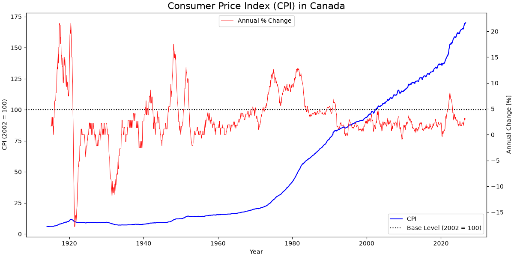

# FINE3300-2026-A2-Calculator
For FINE 3300 Assignment 2, I built a Python calculator that uses Canadian Consumer Price Index (CPI) data to compare the cost of the same basket of goods and services in two different months.

## Project Overview

The CPI measures the price of a fixed basket of goods and services that households buy, such as food, shelter, clothing and transportation. Statistics Canada publishes it monthly and the change in the CPI over time is used to measure inflation. The index is scaled so that the average CPI in 2002 is 100.

The Bank of Canada's inflation calculator only accepts a year for each period, even though the underlying data is monthly. My version accepts both a month and a year for each date.

The program saves a graph of Canadian CPI and its 12-month percentage change, then asks for a price and two dates in the terminal. The results show a set of calculations including the adjusted price, the CPI for both dates, the total percentage change, the elapsed years and the average annual rate.

## Files

| File | Description |
|------|-------------|
| `CPICalculator.py` | The program, which creates the graph and runs the calculator |
| `STATIC_INFLATIONCALC.csv` | Monthly CPI data in CSV format, downloaded from the [Bank of Canada Inflation Calculator page](https://www.bankofcanada.ca/rates/related/inflation-calculator/) |
| `CPI_Graph.png` | The graph saved by the program |
| `README.md` | Assignment write-up, code structure and sample output |

## How to Run

Install NumPy, pandas and Matplotlib using Python 3:

    python3 -m pip install numpy pandas matplotlib

`CPICalculator.py` and `STATIC_INFLATIONCALC.csv` need to be in the same folder. Open that folder in VS Code (File > Open Folder) and run the file, or run it from a terminal inside the folder:

    python3 CPICalculator.py

The program saves `CPI_Graph.png` and asks for three inputs.

- the price, for example `100` (`$1,000` is also accepted)
- the first date in `YYYY-MM` format, for example `2000-09`
- the second date in `YYYY-MM` format

The program asks again if the price cannot be read as a positive number, the date cannot be read as a year and month, or the requested month is missing from the data. The CSV covers January 1914 through September 2026.

## How the Code Works

The code is organized in a `CPICalculator` class, following the same approach as the Index class from Lecture 5.

The class reads the CSV with `pd.read_csv`, skips the eight lines before the header and converts the date column to pandas dates. It adds year and month columns so the calculator can look up the CPI for the month entered.

I expected 1,353 months in the CSV, but it had 1,355 rows. April 1927 and April 1932 each had an extra April 30 entry. I kept the entries dated on the first of each month so that when `pct_change(12)` goes back 12 rows, it lands on the same month of the previous year.

`plot_graph` plots the CPI on the left axis, adds a dotted line at the base level of 100 and plots the annual percentage change on a second axis on the right using `twinx()`. The graph is then saved with `savefig`.

`calculate` uses the same formulas as the Bank of Canada calculator to calculate the adjusted price and total percentage change. It works out the elapsed time and annualized rate using the two months entered.

- new price = price * (CPI 2 / CPI 1)
- percent change = (new price - price) / price * 100
- number of years = number of months between the two dates / 12
- average annual rate = ((CPI 2 / CPI 1) ^ (1 / abs(years)) - 1) * 100, calculated with NumPy

To verify the results, I entered $100 from 2000 to 2020 on the Bank of Canada website. The website used September for both years when I checked and returned $142.46, a 42.46% change over 20 years and an average annual rate of 1.79%. Entering 2000-09 and 2020-09 in my calculator produces the same results.

## CPI Graph

The blue line shows the CPI (left axis), the red line shows the annual percentage change (right axis) and the dotted line marks the base level of 100.

### Commentary

Canada's CPI rose from 6.0 in January 1914 to 170.0 in September 2026. That puts the overall price level in September 2026 at about 28 times what it was in January 1914.

The biggest swing I noticed was in the early 1920s. Prices were rising quickly in 1920, but by the next year they were falling sharply. The CPI also fell during the Great Depression. Later on, the chart shows a jump in inflation after World War II and another stretch of high inflation in the 1970s and early 1980s, where the CPI line gets noticeably steeper.

There were a couple of shorter dips below zero in 2009 during the financial crisis and again when COVID-19 hit in 2020. What stood out to me was how quickly inflation picked up after the 2020 dip. Inflation climbed through 2021 and reached 8.1% in June 2022, its highest rate in nearly 40 years. This was mostly caused by supply disruptions and shifts in demand during the pandemic.

By September 2026, inflation had slowed again, but the CPI was still higher than it was in 2022. You can see that on the graph as the red line comes down while the blue line keeps trending up.

## Sample Output

**$100 from September 1950 to October 2010:**

    ----------------------------------------
    Welcome to the Advanced Inflation Calculator
    Data available is from January 1914 to September 2026
    Please follow the following steps to calculate the inflation between the two dates
    ----------------------------------------
    Enter the base price: 100
    Enter the first date (YYYY-MM): 1950-09
    Enter the second date (YYYY-MM): 2010-10
    ----------------------------------------
    A basket costing $100.00 CAD in September 1950 would cost $924.41 CAD in October 2010.
    ----------------------------------------
    CPI for first date (September 1950): 12.7
    CPI for second date (October 2010): 117.4
    ----------------------------------------
    Percent change: 824.41%
    Number of years: 60.08
    Average annual rate of inflation: 3.77%
    ----------------------------------------
    For more information, the historical CPI graph is saved in the project folder as CPI_Graph.png

## Sources

- Statistics Canada, monthly Canadian CPI, series V41690973 (2002 = 100). This is the data series in the project CSV.
- The [Bank of Canada Inflation Calculator](https://www.bankofcanada.ca/rates/related/inflation-calculator/) provided the CSV, the price adjustment formula and a benchmark for checking my results.
- The Bank of Canada's [Understanding the consumer price index](https://www.bankofcanada.ca/2021/05/understanding-consumer-price-index/) explains what the CPI measures and how to read changes in the index.
- FINE 3300 class materials and lecture slides, including the Index class example from Lecture 5.
